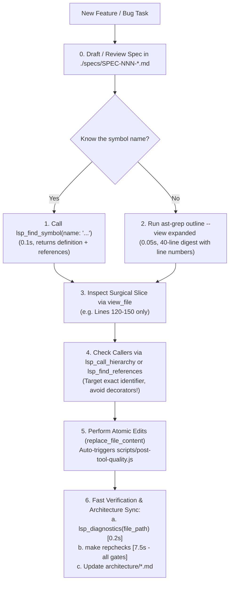

# 07. AI Agent Fast-Navigation Playbook & Spec-Driven Workflow

## 1. Golden Rules for AI Navigation

When working on this repository, AI agents must **never** read entire files blindly or use raw text grepping when navigating unfamiliar code. Doing so consumes tens of thousands of tokens and introduces severe latency.

Follow this benchmarked, high-speed sequence:

---

## 2. Fast Navigation Cheat Sheet

| Task                                      | Tool Call                  | Command / Parameters                      | Expected Latency | Token Footprint             |
| :---------------------------------------- | :------------------------- | :---------------------------------------- | :--------------- | :-------------------------- |
| **Locate Symbol Definition & Usages**     | `lsp_find_symbol` (MCP)    | `name: "MapViewComponent"`                | **0.1s**         | ~25 lines                   |
| **Inspect File Structure & Line Numbers** | `run_command`              | `ast-grep outline --view expanded <file>` | **0.05s**        | ~40 lines (**95% savings**) |
| **Inspect Dependencies / Imports**        | `lsp_file_imports` (MCP)   | `file_path: "..."`                        | **0.2s**         | ~20 lines                   |
| **Trace Function Call Hierarchy**         | `lsp_call_hierarchy` (MCP) | `file_path: "...", line: 120, column: 3`  | **0.2s**         | ~30 lines                   |
| **Type Check After Edits**                | `lsp_diagnostics` (MCP)    | `file_path: "..."`                        | **0.2s**         | ~10 lines                   |
| **All Repository Checks & Tests**         | `run_command`              | `make repchecks`                          | **7.5s**         | Terminal output             |
| **Structural AST & SAST Check**           | `run_command`              | `make lint-rules`                         | **0.2s**         | Terminal output             |
| **Full Project Type & Syntax Check**      | `run_command`              | `make lint`                               | **0.5s**         | Terminal output             |

---

## 3. The Critical Decorator Trap Warning

> [!CAUTION]
> **NEVER call `lsp_find_references` on framework decorator lines (`@Injectable`, `@Component`, `@Output`)!**
> Doing so instructs the TypeScript language server to search for references to Angular framework decorators across thousands of files in `node_modules`, resulting in a **3-minute stall/timeout**.
>
> **Always use `ast-grep outline` to obtain the exact coordinate of the class name or method identifier** (e.g. `export class StateService` at Line 10, Col 14) before querying references.

---

## 4. Spec-Driven Lifecycle & Specialist Subagents

1. **Specs First (`./specs/SPEC-NNN-<Title>.md`)**: Follow `.agents/skills/spec-authoring/SKILL.md` to draft proposals before authoring an `implementation_plan.md`.
2. **Quarantine Pattern (`local_only/`)**: Keep personal profile exports, legacy planning docs (`local_only/openspec/`, `local_only/future_ideas/`), and `local_only/todo.md` inside `local_only/` (ignored by git).
3. **Specialist Subagent Personas (`.agents/agents/` & `.agents/skills/subagent-catalog/SKILL.md`)**:
   - `gis-state-auditor`: Audits Leaflet layer services, coordinate math, parent region/country roll-up, and Schema V4 migrations.
   - `visual-auditor`: Verifies Angular UI layout, Leaflet map canvas, modals, and zero console errors via `chrome-devtools-mcp` on `http://localhost:4200`.
   - `security-sanitizer`: Audits `LocalStorageService` schema protection, `escapeHtml()` popup sanitization, and `ast-grep`/skill safety rules.
   - `spec-architect`: Drafts `specs/SPEC-NNN-*.md` and synchronizes living architecture in `architecture/*.md`.
   - `harness-optimizer`: Conducts post-session retrospectives, extracts repeated commands into `Makefile` targets, authors `ast-grep` rules, and hardens the agentic harness.

---

## 5. Software Craftsmanship & Agentic Engineering Invariants

Grounded in `software_craftsmanship_engineering_principles.md` and `AGENTS.md`:

1. **Ephemeral Tooling & Temp-Space Processing**: Never dump raw payloads (>100 lines) into context. Stream large JSON datasets, logs, or GeoJSON boundaries to `<conversation-id>/scratch/` or `/tmp/`, peek structure with `head`/`jq`, and compute answers with deterministic CLI scripts.
2. **Fail Fast & Zero Silent Fallbacks**: Empty catch blocks, swallowed errors, and dummy fallback returns (`null`, `[]`, `{}`) are strictly prohibited in service layers. Errors must be rethrown, handled explicitly, or logged via `LoggerService.error()`.
3. **Vertical Slices & Tracer Bullets**: Decompose large features into thin, sequential checkpoints: Data Models $\rightarrow$ Vitest Specs $\rightarrow$ Core Services $\rightarrow$ Component UI. Compile and test each slice before expanding.
4. **The AI Boy Scout Rule & Anti-Slop Discipline**: Leave every file cleaner than you found it. Before submitting work, prune speculative abstractions (YAGNI), tighten loose types, and verify zero leftover debug statements.
5. **Session Meta-Learning**: At session wrap-up, analyze tool call logs and git diffs to codify repeated workflows into `Makefile` targets or `ast-grep` rules.
